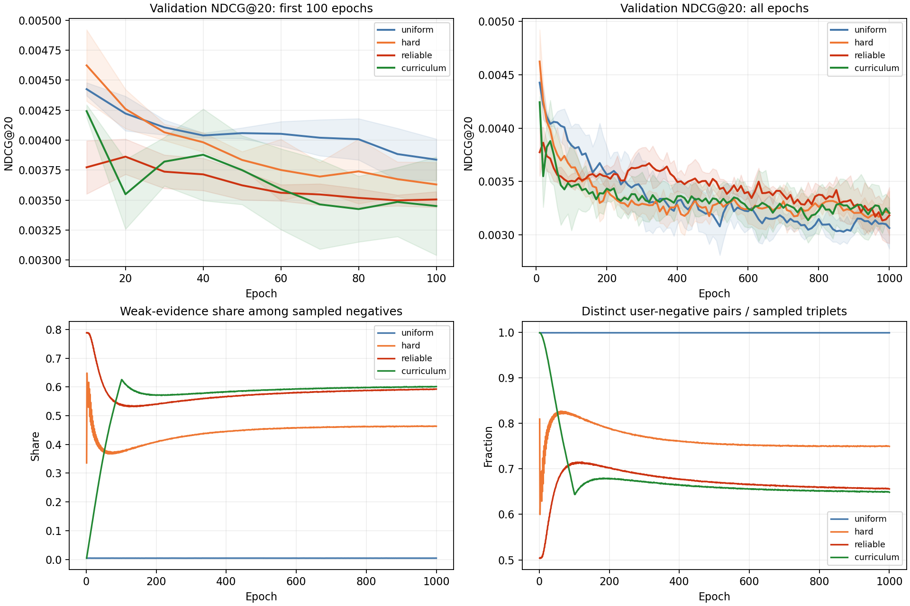

# 第一阶段正式实验：验证记录分析与下一轮方案

分析日期：2026-10-15。输入：项目根目录的 `stage1_validation_review.tar.gz`。正式套件为服务器上的 `runs/stage1_v1`，不包含两轮的 smoke 实验。

## 1. 当前判断

训练记录完整，但当前第一阶段改进尚不能认定成功。所有方法都存在后期验证 NDCG 低于早期最佳值的现象。hard 有小幅但不稳定的收益；reliable 早期明显弱于 hard；curriculum 缓解了 reliable 的早期劣势，但按最佳验证模型比较仍弱于 uniform。

优先工作是补充简单参照、检查训练与验证分布、降低证据权重的干预强度，并缩短诊断实验。暂不把结果归因于某一个已被证明的错误，也不直接叠加强化学习或第二阶段图连接模块。

本报告所有推荐指标均来自 **validation**。没有测试指标；不能把验证表现写成测试收益或统计显著的提升。

## 2. 完整性与证据范围

已检查：

- 12 组实验，每组连续记录第 1–1000 轮，没有缺轮或重复轮，共 12000 条训练记录。
- 每 10 轮一次验证，每组 100 次，共 1200 条验证记录。
- 每轮 451741 个训练 triplets；四组的采样计数、候选打分预算和课程比例符合配置。
- 训练 loss、时间和验证指标均为有限合法值。
- `completion.json` 中的最佳轮次和最佳 NDCG 与逐轮记录一致。
- 验证集始终为 10005 个用户；分组用户数和度数阈值始终相同。
- 套件记录的 16 个源文件 SHA256 与本地源码全部一致。

包中没有模型检查点、prepared manifest、原始数据和各组环境记录，因此不能从这个包校验 checkpoint 的实际内容、重新计算预测，或确认预处理数据与本地另一次准备的数据完全相同。日志完整性检查也不能代替数据与评估正确性检查。

原始 `code/`、`scripts/` 与训练配置均未修改。新增工具放在 `analysis/` 中，避免改变旧检查点要求的源码指纹。

## 3. 主指标：早期模型优于最终模型

以下为三个种子的均值。best 是每组按验证 NDCG@20 选择的 checkpoint；对应的 Recall 也来自同一个 checkpoint，并非独立挑选 Recall 最大值。下降比例计算为 `1 - 最终均值 / 最佳均值`。

| 方法 | 最佳轮次，种子 2020/2021/2022 | 最佳 NDCG@20 | 第 1000 轮 NDCG@20 | 相对最佳下降 | 最佳模型 Recall@20 | 最终 Recall@20 |
|---|---|---:|---:|---:|---:|---:|
| uniform | 10 / 10 / 10 | 0.004426 | 0.003064 | 30.76% | 0.009911 | 0.006987 |
| hard | 10 / 10 / 10 | 0.004624 | 0.003201 | 30.76% | 0.009644 | 0.007006 |
| reliable | 10 / 20 / 20 | 0.003893 | 0.003182 | 18.26% | 0.007666 | 0.007053 |
| curriculum | 10 / 40 / 10 | 0.004256 | 0.003205 | 24.69% | 0.009242 | 0.006329 |

四种方法的最佳 NDCG 的种子样本标准差分别为 0.000054、0.000297、0.000130、0.000049。最终 NDCG 的标准差分别为 0.000195、0.000209、0.000263、0.000135。完整精度见 `results/method_summary.csv`。

### 3.1 对前述初步判断的补充

按照最佳验证模型比较：

- hard 相对 uniform 的 NDCG 均值提高 4.48%，2/3 个种子提高，但 Recall 均值反而下降；不能说所有推荐指标都提高。
- reliable 相对 hard 的 NDCG 均值下降 15.80%，3/3 个种子下降。
- curriculum 相对 reliable 的 NDCG 均值提高 9.33%，3/3 个种子提高；相对 uniform 则下降 3.82%，3/3 个种子下降。

按照固定第 1000 轮比较：

- hard 相对 uniform 的 NDCG 均值提高 4.47%，2/3 个种子提高。
- reliable 相对 hard 仅下降 0.60%，且 2/3 个种子提高，已经不再是早期那样一致落后。
- curriculum 相对 reliable 仅提高 0.73%，2/3 个种子提高。
- curriculum 相对 uniform 的 NDCG 均值提高 4.60%，3/3 个种子提高，但最终 Recall 均值低于另外三组。

因此，不能将“reliable 在最佳模型上下降 15.80%”扩大成“所有训练阶段都下降 15.80%”。当前差异明显依赖模型选择规则和所看指标。三个种子也不足以自动推出统计显著性。

### 3.2 曲线说明什么



图中上方为 NDCG 的种子均值，阴影为样本标准差，不是置信区间；下方为采样诊断的种子均值。

uniform 第 10 轮平均 loss 为 0.193670，到第 1000 轮降至 0.015439；同时 NDCG 从 0.004426 降至 0.003064。其他方法也呈现最佳模型明显早于最终模型的现象。这支持“继续降低当前训练目标没有转化为验证收益”的判断。

原因可能涉及过拟合、训练与随机曝光验证目标之间的分布差异、负采样目标与排名目标不一致等；仅凭这些记录无法将原因唯一定位为过拟合。四组训练样本分布不同，loss 的绝对大小也不适合作为方法优劣的直接比较。

9/12 组在第一次验证（第 10 轮）就达到最高值。第 1–9 轮并未验证，真正最佳点可能更早，因此下一轮应增加早期验证频率。当前课程长度为 100 轮，而课程组最佳轮次只有 10、40、10，其最佳模型均未经历完整课程。

## 4. 可靠性采样的主要风险：弱反馈干预强，且负例集中

### 4.1 实际选中了什么

默认明确负反馈权重为 1，弱反馈为 0.2，未知为 0.05。从记录的平均权重及明确负反馈占比，可反推弱反馈占比：

```text
平均权重 = 0.05 + 0.15 × 弱反馈占比 + 0.95 × 明确负反馈占比
```

该计算恢复的是证据类别比例，不是真实“不喜欢”概率；float32 平均值会带来很小数值误差。

第 10 轮的三个种子均值：

| 方法 | 弱反馈负例占比 | 明确负反馈负例占比 | 不重复用户—负物品对 / 当轮样本数 |
|---|---:|---:|---:|
| uniform | 0.45% | 0.00030% | 99.88% |
| hard | 49.68% | 0.03638% | 72.37% |
| reliable | 77.96% | 0.37256% | 51.24% |
| curriculum | 7.36% | 0.01955% | 98.72% |

reliable 的负例主要来自弱反馈，并非主要来自明确拒绝。第 10 轮约 451741 次负例抽样只覆盖约 231470 个不同的用户—负物品对；同一对被反复抽到的现象明显多于 hard。这里不是“全局不同负物品数”，也不是“不同用户数”。

第 1000 轮 reliable 的弱反馈占比仍约 59.24%，不同用户—负物品对占比约 65.58%。加权机制确实改变了采样行为，并非参数没有生效。

### 4.2 为什么现有权重可能过强

当前选择公式为：

```text
adjusted_score = model_score / temperature + beta × log(confidence)
```

默认 temperature=1、beta=1。相同模型评分下，弱反馈相对未知样本获得 `log(0.2/0.05)=1.3863` 的优势，明确负反馈相对弱反馈获得 `log(1/0.2)=1.6094` 的优势。

这是模型内积评分单位上的偏移，并不是“20% 对 5%”这样直接可解释的真实负例概率。当前没有记录候选原始分数分布，所以尚不能量化它压过了多少模型分数差。但可靠组早期极高的弱反馈占比与较低的不重复对占比，使“证据项过强、候选选择集中”成为优先验证的解释。

另一个实现层面的事实：当前是确定性 argmax，temperature 没有用于 softmax 抽样。因此

```text
argmax(score / T + beta × log(c))
= argmax(score + T × beta × log(c)), T > 0
```

在这一选择规则下，temperature 与 beta 对选择的作用通过乘积耦合；固定 beta=0 时，改变正温度不改变排序。下一轮不要把它们当作两个独立的探索参数同时搜索。

### 4.3 现有对照能证明什么

hard / reliable / curriculum 的候选规则一致：20 个候选，一半从用户训练负证据池抽取，其余从合法全物品中随机抽取。hard 已经使用了证据候选，不能把它称为纯均匀候选上的困难负采样复现。

在同候选规则下，hard 与 reliable 对照可以诊断评分加权的影响；uniform 与 hard 的差异同时包含候选来源和困难选择，尚不能隔离二者贡献。

课程组第 10 轮的定向比例为 7.2%，第 40 轮为 31.2%，第 100 轮为 79.2%，第 101 轮起为 80%。它的早期优势可能部分来自降低了有害采样干预，不能据此证明长课程本身是最优方案。

## 5. 分组结果：长尾仍几乎没有命中

以下仍按整体最佳验证 NDCG 选择每组 checkpoint，然后计算分组均值。

| 方法 | 稀疏用户 NDCG@20 | 活跃用户 NDCG@20 | 长尾物品 NDCG@20 | 三个种子的长尾命中个数 |
|---|---:|---:|---:|---|
| uniform | 0.004400 | 0.004751 | 0.000000 | 0 / 0 / 0 |
| hard | 0.003789 | 0.005152 | 0.00000571 | 1 / 0 / 0 |
| reliable | 0.002937 | 0.004559 | 0.00002650 | 1 / 1 / 0 |
| curriculum | 0.004662 | 0.004309 | 0.00000656 | 0 / 1 / 0 |

稀疏用户为训练正交互数不超过 6 的用户，共 1843 人；活跃用户为超过 25 的用户，共 3214 人。长尾物品为训练正向度大于 0 且不超过 14 的物品；5833 个验证用户至少有一个该组目标。

长尾指标是“全物品排名上的长尾真值指标”，不是只在长尾池内部排名。命中个数从 `precision × 用户数 × K` 反推并检查为整数，是命中的用户—目标物品对数量。

最终模型的长尾命中也只有 uniform 0/0/0、hard 3/0/2、reliable 3/2/0、curriculum 6/3/0。极少量命中就足以造成很大的相对提升，不能把从 0 到几个命中解释成稳定解决长尾问题。

232 个验证用户含训练零正向度物品目标；所有 1200 次验证中，该物品组的命中均为零。训练零正向度与低度数应分别处理：仅凭当前协同图，没有正边的物品无法从邻居获得正向协同信息；残差连接本身也不提供真实偏好证据。

这些结果说明第二阶段应保留长尾、稀疏用户和零正向度的独立评估，但不证明“边缘缓存＋连接指针”一定有效。第一阶段尚未稳住，不宜立即叠加新传播模块，否则收益来源更难辨认。

## 6. 耗时只能作为本次运行记录

12 组记录的 `epoch_seconds` 合计约 35.16 小时。每组均值：uniform 2.91 小时、hard 3.73 小时、reliable 2.79 小时、curriculum 2.29 小时。

这些时间不含进程启动和每轮 checkpoint 保存；snapshot_seconds 已包含在 sampler_seconds 中，不能重复相加。显存数值是 PyTorch 峰值 allocated memory，不能当作整张 GPU 占用。

虽然样本数、batch size 和训练主体一致，平均单轮训练时间却依次约为 7.34、7.25、4.09、2.47 秒；uniform 的三组约为 7.33 秒，而 curriculum 的三组约为 2.47 秒。归档没有 GPU/环境/系统负载记录，无法判断共享服务器负载、设备或运行状态变化的具体影响。

因此暂不声称 curriculum 训练更快或 reliable 降低了训练计算复杂度。下一轮记录环境和负载，必要时交错运行对照，分别报告训练、采样、验证及端到端耗时。

## 7. 下一步先补验证集参照

新增 `evaluate_validation_references.py`，只在 validation 上运行，保持原训练与最终测试方案不变：

1. 均匀随机排名的精确期望，使用每个用户屏蔽训练正交互后的合法候选数计算，不依赖随机种子。
2. 训练热门物品排名，热门度为唯一训练正交互度；同热门度时按物品 ID 升序。与现有模型使用相同的屏蔽及分组评价。
3. 数据清单、证据覆盖和验证目标历史证据审计。未来正例与先前弱反馈重合只能作为诊断，不反向用于排除训练负例。

该工具检查 suite 的数据清单 SHA 和原源码 SHA；FeedbackDataset 还会验证清单中各文件 SHA。这样不会拿另一份本地准备数据冒充服务器正式数据。

将 `stage1_review_tools.tar.gz` 上传到服务器项目根目录后，逐行执行下面两条单行命令，不需要 shell heredoc：

```bash
tar -xzf stage1_review_tools.tar.gz -C .
```

```bash
python analysis/stage1_validation_20261015/evaluate_validation_references.py --suite-dir runs/stage1_v1 --output runs/stage1_v1/validation_references.json --device cpu
```

输出文件不能覆盖已有结果。若文件已存在，保留它并换一个新输出文件名。若数据或源码指纹不匹配，先检查版本，不删除校验逻辑。

这两条命令不会训练模型或评价 test，也不会创建或修改 `final_test_plan.json`。脚本会加载 prepared dataset 并核验文件，但仅使用训练数据及 validation 目标计算指标。

将 `runs/stage1_v1/validation_references.json` 传回后，就能判断：模型是否优于简单热门策略、是否显著偏离随机期望，以及数据中的明确负反馈是否足以支持原定机制。当前绝对 NDCG 较小，缺少这两种参照时，不应凭数值大小断言数据或评估错误。

## 8. 建议的下一轮消融顺序

下面是待确认的实验设计，尚未启动或改动训练实现。

### P0：先完成基础诊断

运行上面的验证参照；审查数据清单中的去重协议、正反馈定义、随机曝光目标和反馈覆盖。随后补候选分数范围、证据修正后的选中类别、每个用户的证据池大小及重复负例计数。当前日志缺少候选原始分数，不能仅凭 1.3863 的偏移就认定实际支配程度。

### P1：先减小 beta，其他因素固定

用种子 2020 做 100 轮诊断，每轮验证一次；先跑 uniform，再用 reliable 模式固定候选数 20、证据候选比例 0.5、定向比例 0.8、temperature=1，比较 beta 为 0、0.05、0.1、0.25、1 的情况。

beta=0 在相同初始状态、候选及温度下退化为 hard 选择，是重要对照。beta=1 是当前 reliable 的重复诊断条件。这里比较的是不同证据干预强度，不预设某个新值一定更好，也不同时改学习率、网络层数、候选来源和课程。

100 轮只是根据本次早期峰值设置的诊断窗口，不等于证明所有配置的最优训练预算都是 100。若新配置仍在窗口末端改善，应延长验证观察，而不是机械截断。

### P2：再拆候选池和选择规则

若较小 beta 仍不改善，增加 evidence_fraction=0 的纯随机候选 hard 对照，再逐步比较 0、0.25、0.5。固定候选总数和已选 beta，隔离“从哪里提出候选”与“如何选择候选”。

只有证据加权有可重复收益后，再比较定向比例或更短课程。当前早期峰值与 100 轮课程明显错位，可以把 5、10、20 轮作为后续诊断候选，但不能与 beta 搜索同时混在一组变化里。

### P3：通过三个种子复核，再推进方法创新

保留同一数据、相同评价规则和验证模型选择规则，复核总体与分组指标、负例集中程度和成本。若可靠性加权得到稳定收益，再考虑按用户证据覆盖/不确定性限制干预、对弱反馈进行校准、对重复负例设置限制等扩展。

这些扩展目前只是机制方向，尚不能称为已验证创新，也不等同于在线强化学习。第二阶段传播结构与真实用户反馈策略继续保留为后续模块。

## 9. 最终测试与旧实验保留

本次原协议以固定预算后的 `last.pt` 为默认正式比较；本报告同时诊断 best_val，并不修改原协议。如果已经存在最终测试计划或已有测试结果，继续使用既定 checkpoint 规则。

如果尚未测试，任何统一改用 best_val 的决定都应在第一次看 test 前书面固定，并说明它代表另一种模型选择规则。不要删除 `final_test_plan.json` 来切换；也不要观察 test 后选择更好的一套结果。新消融仍只使用 validation 调参。

完整保留服务器上的 suite、metadata、launches、metrics、last.pt、best_val.pt、completion、同版源码及 prepared 数据。当前返回包只有诊断日志，不能代替完整实验备份。

## 10. 分析复现与交付文件

本地复现命令（输出目录必须是新目录）：

```bash
python analysis/stage1_validation_20261015/analyze_validation.py --archive stage1_validation_review.tar.gz --output-dir analysis/stage1_validation_20261015/results_recheck --plot
```

- `analyze_validation.py`：只读取归档成员，不解压、不执行其中内容；使用标准库分析，绘图可选依赖 matplotlib。
- `results/validation_analysis.json`：审计、源文件匹配、均值/标准差、种子配对差异和局限。
- `results/run_summary.csv`：12 组逐运行汇总。
- `results/method_summary.csv`：4 种方法汇总。
- `results/checkpoint_groups.csv`：best_val / last 的分组指标与命中数量。
- `results/epoch_means.csv`：各轮采样统计及验证指标的种子均值。
- `results/validation_and_sampling.png`：已检查布局的验证曲线及采样诊断图。
- `evaluate_validation_references.py`：在服务器原始数据上补验证参照，不影响训练源码指纹。

额外验证：随机期望公式已与小型数据上所有合法排名的穷举均值逐项比较，K=1、2 的 Precision/Recall/NDCG 一致；热门参照已检查训练正例屏蔽、排序和分组一致性。没有声称在缺失的服务器权重或正式数据上重新执行过模型评估。
